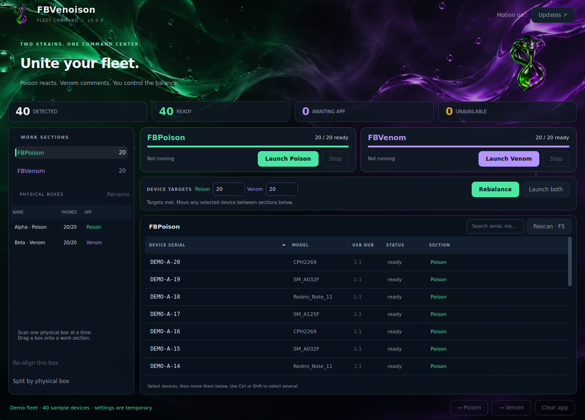

# FBVenoison 3.0 — fleet command

FBPoison and the bundled FBVenom run in separate processes, each restricted to
its assigned devices. FBPoison handles reactions; FBVenom includes Comments,
Comment to Comment workspaces, and its own AI settings. The hub uses the current
bundled Python sources, imported from `/home/kaneki/FBVenom/` (version 1.1.1).
The imported app includes the new Venom interface, live-link support,
diagnostics, and its updater. Explicit executable overrides take priority; packaged
launches otherwise prefer apps shipped beside the hub over legacy home folders.



## Run

```bash
python fbvenoison.py
```

The existing access key still applies. Install PyQt6 for the hub, and the child
apps' dependencies (including uiautomator2, adbutils and Pillow) for source
launches. Install Android platform-tools and keep `adb` on PATH, or set
`ADB_PATH` to one shared ADB binary for the whole suite.

FBPoison credentials stay in ignored `FBPoison/poison_private.json` beside the
app. Copy `poison_private.example.json` for a fresh installation, or set
`GROQ_API_KEY` and `FBPOISON_UPDATE_TOKEN` in the environment. Private settings,
device captures, logs, and generated binaries are excluded from Git.

Explore the interface without an access key, phones, ADB calls, child launches,
or changes to your saved configuration:

```bash
python fbvenoison.py --demo
```

Preview scanned devices and saved groups without opening the UI or saving:

```bash
python fbvenoison.py --boxes
```

## Devices: 20 / 20, adjustable

The **Device targets** controls default to **20 Poison / 20 Venom**. Set either
target from 0–1000 and click **Rebalance** to apply it. Changing a number saves
the target without moving phones. Rebalance keeps existing ready assignments
where possible, fills vacancies, and leaves surplus ready phones awaiting an
app. If fewer ready phones exist than requested, it shares them proportionally
(30 ready phones for 20/20 gives 15/15). Ready counts exclude offline and
unauthorized devices; their saved destinations remain intact for reconnects.

Select a work section or physical box to see its phones. Select one or more
rows and use **→ Poison**, **→ Venom**, or **Clear app** to move them. Ctrl and
Shift select multiple rows. Individual moves may exceed a target: targets are
planning values, while your manual assignments remain authoritative until you
choose Rebalance again. Search filters the table without changing assignments.

Stop affected apps before moving their phones. Stop both apps before
rebalancing. Every rebalance saves a `boxes.before-realignment-*.json` backup
before committing the new assignment. Failed saves leave the previous live
assignment intact. Targets, manual choices, physical groups, and motion
preferences persist in `boxes.json` (`FBVENOISON_CONFIG` overrides its path).

## Physical phoneboxes

Capture one physical box at a time using **Rescan** or F5. A named box appears
immediately, fills to 20 members, and keeps its name/membership across rescans
and unplugging. A fresh cohort of 20 creates a separate box. ADB cannot infer
physical boxes with no USB information when they first appear simultaneously.

Drag a named box onto a work section to move every member, including currently
disconnected members. With a box selected and no rows selected, the footer's
**Box →** buttons do the same. **Mixed** means members have different app
assignments. Double-click a name or use **Rename** to rename it.

**Split by physical box** routes whole captured boxes alternately to Poison and
Venom. This preserves physical-box boundaries; **Rebalance** instead follows
the requested device counts and may split a physical box between apps.

For a mistaken capture, keep only the intended physical box powered on, select
it, and use **Re-align this box**. The hub backs up the configuration before
replacing that physical group's membership with the current scan (1–20
phones). Ordinary rescans do not discard disconnected members.

## Fusion interface

The generated logo combines a venomous serpent and poison droplet. The login
screen, window icon, and dashboard share it. The generated green-and-violet
liquid background scales to the window and animates with slow drift, light,
and droplets. Use **Motion on/off** to pause it; animation pauses while hidden
and stops repainting while minimized. A resizable sidebar and scrolling
controls support compact windows down to 960 × 720.

Generated image sources and prompts are recorded in
[`assets/branding/SOURCES.md`](assets/branding/SOURCES.md).

## Suite updater

Open **Updates**, enter your publisher's HTTPS manifest URL, then select
**Save & check**. No publisher feed is configured by default. The feed returns:

```json
{
  "version": "3.1.0",
  "url": "https://your-release-host.example/FBVenoison-3.1.0.zip",
  "sha256": "<64 hexadecimal characters from the release package>",
  "notes": "Describe what changed."
}
```

Checks and downloads run in the background. **Download release** stages only a
SHA-256-verified archive or installer in `updates/` beside `boxes.json`;
partial or corrupt downloads are discarded. **Open download folder** opens the
staged package's location. Stop both apps, preserve your local settings, install
the downloaded release, and restart. The updater stages a release for manual
installation; it does not replace or execute files in a running suite.

The feed URL persists in `update_config.json`. See
[`update_config.example.json`](update_config.example.json).
`FBVENOISON_UPDATE_URL` sets the initial feed; `FBVENOISON_UPDATE_DIR` changes
the updater's settings/download location.

## Windows releases

The hub EXE in this folder predates these interface changes. The upstream
FBVenom 1.1.1 EXE was also copied from `/home/kaneki/FBVenom/dist/`, but it does
not implement the hub's assigned-device protocol. Source launches use the
integrated new version now. Rebuild on Windows to use it through a frozen hub
with the device split enforced. From the project
folder, with dependencies, PyInstaller, and Android platform-tools installed:

```powershell
.\build_windows.ps1
```

Set `FBVENOM_PLATFORM_TOOLS` to Google's extracted Windows platform-tools
directory, or install them under `$env:LOCALAPPDATA\Android\platform-tools`
for the script to detect them. The script builds both children and
the branded hub from source into `release/FBVenoison/`. It does not copy private
AI keys, account data, device assignments, debug logs, or screenshots into the
release. Configure each app's AI settings on the target installation. For an
existing installation, preserve its local configuration files when replacing
executables. Point `FBVENOISON_POISON_EXE` or `FBVENOISON_VENOM_EXE` at a specific
child executable to override bundled launch resolution. A managed FBVenom
build emits `FBVenom.suite-bridge.json` beside its EXE; keep this matching
file with the binary. The hub refuses a frozen Venom binary without that
verified bridge, preventing it from taking devices assigned to Poison.

The bridge applies the hub's device list, shared ADB path, and existing unlock.
While managed by the hub, FBVenom's own binary replacement actions direct you
to update the suite, so an upstream standalone update cannot remove that
integration. Its standalone updater retains its normal behavior.

The hub's PyInstaller spec embeds the generated assets and updater. Child apps
remain external processes under `FBPoison/fbpoison.exe` and
`FBVenom/FBVenom.exe`; this keeps their identically named `core`/`gui` modules
isolated. The source bootstrap filters each child's `core.list_devices()`.

## Verify

```bash
python tests/run_all.py
```

Tests use temporary settings and fake ADB fleets. They cover flexible targets,
manual moves, physical capture/realignment, drag/drop, isolated child launches,
packaged app resolution, authentication, and verified updater downloads. The
bundled FBVenom also has workspace and live-counting tests in its own folder.
